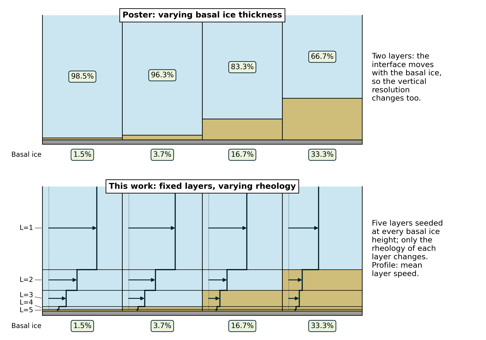
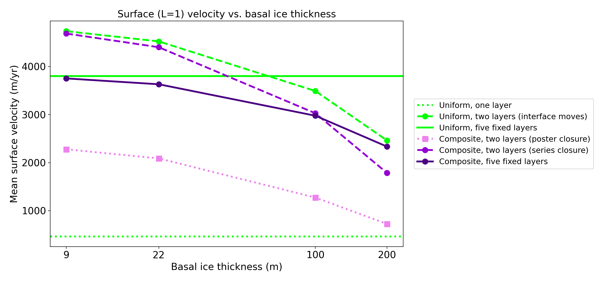
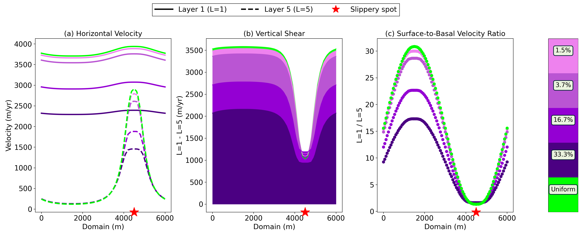

# Soft basal ice in ISMIP-HOM D, with the layers held fixed

A follow-up to Brooklyn Wright's poster *Evaluating the Effect of Soft
Basal Ice on Glacial Flow* (Wright, Narayanan & Chu; AGU 2026). The poster
ran a two-layer column and moved its one interface to make the basal ice
thicker (1.5, 3.7, 16.7 and 33.3 % of the column: 9, 22, 100 and 200 m of
600 m). Moving the interface changes two things at once: the rheology of
the ice near the bed, and where the model resolves vertical shear. Here
the interfaces are seeded once, at every one of those heights, giving five
layers, and only the number of layers assigned the basal-ice rheology
changes.



## Setup

The poster's experiment, built from the action terms of
[multilayer](https://github.com/hoffmaao/multi-layer) (Jouvet 2015 in
icepack2's dual form) in `ismip_hom_d.py`:

- 6 km periodic slab, 600 m thick, 2.3 degree slope (a uniform body force).
- Linear sliding on ISMIP-HOM D's drag, beta^2 = 1000 + 1000 sin(2 pi x / L)
  Pa yr/m, which vanishes at x = 3L/4: the poster's slippery spot.
- Stratigraphic ice n = 1.8, A = 100 MPa^-1.8 yr^-1; basal ice n = 4,
  A = 1000 MPa^-4 yr^-1 (the poster's table).

Each interface is closed **in series**: the half-layer below shears under
its own law and the half-layer above under its own, at the common interface
stress. So a column of one law gives the uniform answer wherever its
interfaces sit, and the rheology change sits exactly on an interface. The
poster's runs closed every interface with the law of the layer below over
the whole jump (multilayer's default); that is kept as `interface="below"`.

## Experiments

`experiments.py` runs five sets; layers are numbered from the surface down
in the figures, as on the poster (L = 1 is the surface layer).

| set | column | rheology | interface closure |
|---|---|---|---|
| `fixed` | five layers, interfaces at 1.5, 3.7, 16.7, 33.3 % | basal ice in the bottom k = 0..4 layers | series |
| `variable` | two layers, interface at each height | basal below, stratigraphic above | series |
| `poster` | the same | the same | below (the poster's) |
| `split` | the same | stratigraphic throughout | (either; one law) |
| `uniform` | one layer | stratigraphic | none |

Mean surface (L = 1) speed, m/yr, along the centreline:

| basal ice | 9 m | 22 m | 100 m | 200 m |
|---|---|---|---|---|
| `fixed` (no basal ice: 3801) | 3753 | 3631 | 2977 | 2334 |
| `variable` | 4686 | 4402 | 3027 | 1785 |
| `poster` | 2278 | 2088 | 1274 | 724 |
| `split`, no basal ice at all | 4736 | 4523 | 3491 | 2461 |



**Moving the interface is most of the poster's trend.** With no rheology
contrast at all (`split`), moving the two-layer interface from 9 to 200 m
cuts the surface speed by 48 %. In the two-layer runs the basal ice's own
effect is the gap between `variable` and `split`, a few percent below
100 m.

**With the layers fixed, basal ice still slows the glacier here**, by 1 %
at 9 m and 39 % at 200 m (`fixed`). That is the rheology, not an artefact:
the two laws give the same strain rate at 0.35 MPa
(1000 tau^4 = 100 tau^1.8), and the stresses in this slab are below that,
where the n = 4 "soft" ice is the stiffer of the two. Basal ice speeds the
flow only where its stress exceeds 0.35 MPa, or with a rate factor that
makes it softer at these stresses.

**The closure matters as much as the layout.** The `poster` runs, closed
with the law below, are 2-2.5 times slower than the same columns in series,
because the basal law then governs the shear of the whole column, not just
the basal half-layer. Their profiles reproduce the poster's bottom row in
shape, ordering and the peak at the slippery spot, about 20 % lower in
magnitude; the poster's uniform row is not reproduced (the poster's
notebook is needed to pin that down).



Two-layer runs, for comparison: `figures/two_layer_series.png`,
`figures/two_layer_poster.png`, `figures/two_layer_uniform.png`.

## Vertical resolution

Five layers are not converged: the top layer is two thirds of the column,
and the one-layer model (plug flow, 463 m/yr) shows how much vertical shear
a coarse column misses. Subdividing every seeded layer, with stratigraphic
ice throughout:

| layers | no basal ice | basal ice 200 m | ratio |
|---|---|---|---|
| 5 (seeded) | 3801 | 2334 | 0.61 |
| 10 (each seeded layer halved) | 3553 | 2067 | 0.58 |
| 20 (each seeded layer quartered) | 3496 | 2003 | 0.57 |

The speeds converge (5 to 10 layers moves them 7-11 %, 10 to 20 only
2-3 %), and the basal-ice response moves by 4 points over the whole
refinement, so the comparison between rheology assignments holds at five
layers; absolute speeds want ten or more. The refined rows come from
`python experiments.py --only refine` (not part of the default run: the
20-layer runs take 10+ minutes each).

## Running

Firedrake 2026.4.1 (`~/venv-firedrake-2026`), `requirements.txt`, and
icepack2 and multilayer installed editable. Run with `OMP_NUM_THREADS=1`.

```bash
python experiments.py --list     # the runs
python experiments.py            # ~10 min; results/L6000m_nx40/*.npz, skips runs on disk
python plot_results.py           # figures/*.png
python plot_schematic.py         # figures/schematic.png
```

`test_slab.py` checks the layered equations against their closed form on
a uniform-friction slab, where each interface carries the weight of the
ice above it and every layer velocity follows by summing half-layer
shears: n = 4 basal and n = 1.8 stratigraphic ice in every assignment,
both closures, to a relative error of 1e-7.

`poster_style.py` holds the poster's colours and label boxes, so new
figures sit beside its panels.

## References

- Doyle, S. H. et al. (2018). Physical conditions of fast glacier flow: 1.
  Measurements from boreholes drilled to the bed of Store Glacier, West
  Greenland. *JGR Earth Surface*, 123, 324-348. doi:10.1002/2017JF004529
- Jouvet, G. (2015). A multilayer ice-flow model generalising the shallow
  shelf approximation. *J. Fluid Mech.*, 764, 26-51. doi:10.1017/jfm.2014.689
- Pattyn, F. et al. (2008). Benchmark experiments for higher-order and
  full-Stokes ice sheet models (ISMIP-HOM). *The Cryosphere*, 2, 95-108.
  doi:10.5194/tc-2-95-2008
